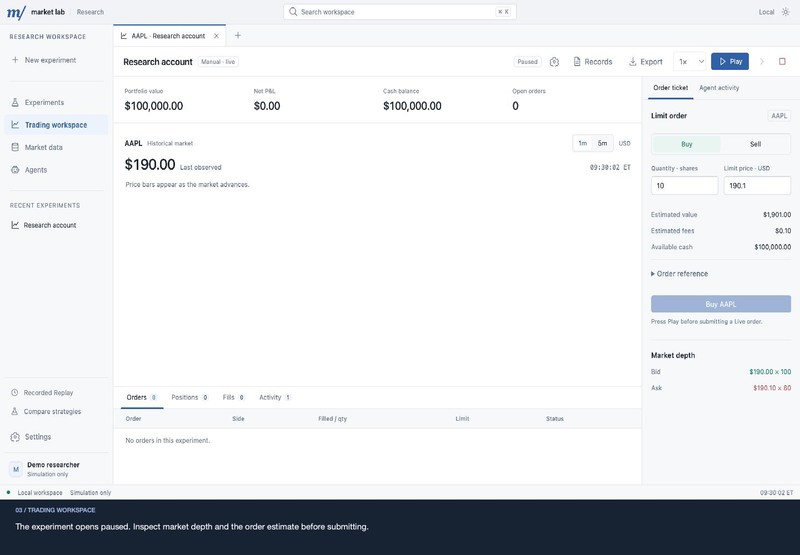

<p align="center">
  
</p>

<h1 align="center" id="market-lab">Market Lab</h1>

<p align="center">
  <strong>Build AI trading agents. Test them against baselines. Replay the record.</strong><br>
  A local research workbench for Python agents, historical markets and simulated accounts.
</p>

<p align="center">
  <a href="docs/user-guide/support.md"></a>
  <a href="docs/user-guide/support.md"></a>
  <a href="LICENSE"></a>
</p>

<p align="center">
  <a href="https://mysterchan.github.io/market-lab/"></a>
</p>

<p align="center">
  <a href="#watch-the-demo">Watch the demo</a> ·
  <a href="#quick-start">Quick start</a> ·
  <a href="#write-an-agent">Build an agent</a> ·
  <a href="docs/README.md">Documentation</a>
</p>

---

Give your agent market tools and a simulated account. Choose its model and Python loop,
observe its orders and fills, then verify the recorded trading operations without calling
the model again. Compare its repeated runs with people, rules and your own neural-network
models on the same market, with confidence intervals and a guard against prices the model
may remember. Use the Desktop to explore an experiment, or work directly with the Python API.

## Watch the demo

[](docs/site/media/demo.mp4)

<p align="center">
  <a href="docs/site/media/demo.mp4"><strong>▶ Watch the walkthrough · 1 min 11 sec</strong></a><br>
  Prepare an experiment → submit an order → inspect a fill → verify a Live run in Replay.<br>
  <sub>Recorded in the real Desktop with synthetic data and no model API calls.
  <a href="docs/user-guide/demo.md">Read the transcript</a>.</sub>
</p>

## From an agent idea to a trading record

<table>
  <tr>
    <td width="50%" valign="top">
      <h3>Bring your own agent</h3>
      Use the built-in template or import a Python project. Choose its model,
      instructions and tools, and replace the agent loop when you need more control.
    </td>
    <td width="50%" valign="top">
      <h3>Let the market keep moving</h3>
      In Live mode, market time continues while the agent analyses data or waits
      for a model. The agent decides when to read, trade, wait or finish. Or run it
      turn-based: the market waits for each decision, to judge the decisions alone.
    </td>
  </tr>
  <tr>
    <td width="50%" valign="top">
      <h3>Inspect the experiment</h3>
      See market data, cash, positions, orders, fills and agent activity together.
      Use manual trading, built-in rules and your own model file (for example a
      neural network) as baselines in the same platform.
    </td>
    <td width="50%" valign="top">
      <h3>Replay without another model call</h3>
      Recalculate the financial outcomes of recorded trading operations.
      Inspect what happened without rerunning the agent or paying for another model response.
    </td>
  </tr>
  <tr>
    <td width="50%" valign="top">
      <h3>Is it really better?</h3>
      Evaluate saved runs side by side: bootstrap confidence intervals, permutation tests
      against a baseline and Holm adjustment. <a href="docs/user-guide/evaluation.md">Evaluation guide</a>.
    </td>
    <td width="50%" valign="top">
      <h3>Rule out memory</h3>
      A language model may have seen a famous stock's prices. Disguise a recording's dates
      and price level, and see which Agent runs used dates the model could know.
    </td>
  </tr>
</table>

| 01 · Prepare | 02 · Run | 03 · Inspect | 04 · Evaluate |
| --- | --- | --- | --- |
| Select data, an account and an Agent revision. | Play a Live experiment or step through a manual, rule or model run. | Follow orders, fills and agent activity in Desktop. | Replay the record and test the Agent against baselines. |

Market Lab runs on your computer. Model requests go to your configured provider;
simulated trades stay in the local experiment. There is no broker connection or real order submission.

## Quick start

**Install a release, no build needed.** Download the installer for your system from the
[latest GitHub Release](https://github.com/Mysterchan/market-lab/releases): a
`.dmg` for macOS, an `.exe` for Windows or an `.AppImage` for Linux. For Python, install
the package from PyPI (its wheels include the native market library), then run the demo:

```bash
python -m pip install market-lab-research
market-lab demo
```

**Or build from source.** Clone or download this repository, then run the following from
its root directory.
The Desktop instructions target **macOS**, with **Python 3.9–3.12**, **Make** and a
**C++17 compiler**. On macOS, install Apple's command-line developer tools if needed.
See [platform support](docs/user-guide/support.md) for Linux and Windows coverage.

```bash
python3 -m venv .venv
source .venv/bin/activate
python -m pip install -r requirements-desktop.txt
make all
python -m sim_platform desktop --demo
```

The demo uses a small synthetic recording and temporary accounts. No historical data download
or model API key is needed. Explore market playback and manual/rule trading; closing the
app removes the demo workspace.

To keep your experiments, launch without `--demo`:

```bash
python -m sim_platform desktop
```

Continue with the [first-experiment guide](docs/user-guide/getting-started.md) to add your
data, configure a model, create an experiment and inspect its results.

## Write an agent

Your project exports `create_agent(context)`. The platform supplies the selected settings,
model adapter and granted tools. For example, `agent.py` can use the built-in loop:

```python
from sim_platform.sdk import TradingAgent


def create_agent(context):
    return TradingAgent(
        model=context.model,
        tools=context.tools.values(),
        instructions=context.settings['initial_prompt'],
        parameters=context.settings['parameters'],
    )
```

You can replace that loop with your own implementation and add local Python tools.
Develop your project separately from the platform; the [SDK guide](docs/agent-development/sdk.md)
explains installation and the Agent interface.

In Desktop, import the project under **Agents**, prepare its Python dependencies, then
select the saved Agent revision in **New experiment**. Choose an account and market data,
wait for preparation, and press **Play**. The [project guide](docs/agent-development/projects.md)
covers configuration and dependency preparation; [examples](examples/agents/README.md)
show a local math tool and a custom resident loop.

## Find your way around

| I want to… | Guide |
| --- | --- |
| Use Desktop, CLI or Replay | [User guide](docs/user-guide/README.md) |
| Compare an Agent with baselines | [Evaluation](docs/user-guide/evaluation.md) |
| Build an Agent or add tools | [Agent development](docs/agent-development/README.md) |
| Integrate from Python | [Platform API](docs/reference/platform-api.md) |
| Understand execution and processes | [Architecture](docs/architecture/README.md) |
| Change, test or release the platform | [Development](docs/development/README.md) |

## Project status

Market Lab **1.0** is a stable release with a frozen public API ([API stability](docs/reference/api-stability.md)). Trading uses
simulated cash with limit and market orders; short selling is optional, with a margin rule, and
there is no leverage. Manual, rule, model-file and Agent experiments can trade
[several symbols](docs/user-guide/several-symbols.md) from one account, in Controlled or
Live mode. Historical recordings are not included. Imported Python is
trusted local code unless you run it in the optional OS sandbox; model-backed experiments
need your own credentials or a local model server. Installers for macOS, Windows and Linux
and wheels with the native library are built by the release workflow. Multi-agent
experiments are future work.
See [support and limitations](docs/user-guide/support.md) and the [roadmap](docs/development/roadmap.md).

Pull requests are welcome; read [contributing](CONTRIBUTING.md) and
[governance](GOVERNANCE.md) first. Bug reports should include reproduction steps,
OS/Python versions and redacted logs; [troubleshooting](docs/user-guide/troubleshooting.md)
covers common problems. For sensitive issues, follow [security reporting](SECURITY.md).
To cite Market Lab, use [CITATION.cff](CITATION.cff).

## License

[Apache-2.0](LICENSE). Third-party components retain their own licenses;
see [third-party notices](THIRD_PARTY_NOTICES.md).
