> 預設 Desktop 已改用新版介面。最新操作請睇 [Desktop 完整操作流程](desktop-workflow-zh-hk.md)；下文保留舊版畫面參考。

# Market Lab Desktop：逐頁圖解指南

呢份指南跟住「加入行情 → 設定實驗 → 人手交易 → 檢查結果 → 驗證記錄」嘅次序行。
第一次用，可以先跟到第 11 張圖；Agents 同 Replay 係之後先學嘅部分。

## 先認清楚三樣嘢

| 名稱 | 代表乜 | 去邊度處理 |
| --- | --- | --- |
| 行情資料 Dataset | 交易所歷史訊息，例如你嗰份 ITCH 檔 | Market data |
| 實驗 Experiment | 某個戶口、行情、費用設定同決策方式組成嘅一次模擬 | New experiment / Trading workspace / Experiments |
| 操作記錄 Operation log | 實驗記低嘅操作，用嚟重建同驗證結果 | Replay |

**Market data 加入 `.bin` 行情檔；Replay 開啟 `.jsonl` 操作記錄。兩者唔係同一種檔案。**

圖中全部係本機 macOS App，以臨時戶口同合成行情擷取，冇用你嘅私人資料，亦冇呼叫模型。
第 7、8、11 張係同一次實際人手交易；第 16、18 張係另一個 Live 規則實驗及其 Replay。第 9、10 張係獨立嘅介面展示資料，唔係前面嗰次交易嘅結果。
淺色同深色只係外觀選擇，唔代表另一個模式。你自己嘅股票、時間、金額同檔案大小可以完全唔同。

主要功能全部留喺同一個主視窗：Market data、交易控制、活動記錄、策略控制、Agent 編輯、建立戶口同研究者都係切頁。
細頁面有 Back／返回入口；Agent 編輯用 Back 會保留草稿，Cancel 先放棄。
只有系統揀檔案／資料夾同重設研究資料等短暫操作會開對話框；加入行情嘅路徑同儲存設定都留喺主視窗內頁。

## 圖 1：未開實驗嘅 Trading workspace

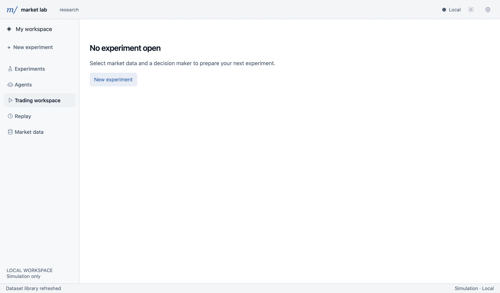

**當時狀態：**冇開啟行情預覽或實驗，所以中間顯示 **No experiment open**。呢個係正常空白狀態。

- 左邊係固定導覽；**My workspace** 係工作空間標題。
- **New experiment** 開始設定一次模擬；唔會一撳就即刻買賣。
- 右上 **Local** 表示本機工作空間；唔代表連咗券商或者即時報價。
- 太陽／月亮按鈕切換外觀，齒輪開 Settings。
- 底部顯示操作狀態；載入錯誤亦會喺呢度提示。

**下一步：**有自己行情檔就去 Market data；只想試操作，可以用 `--demo` 開示範版。

## 圖 2：Market data，管理已加入嘅行情檔

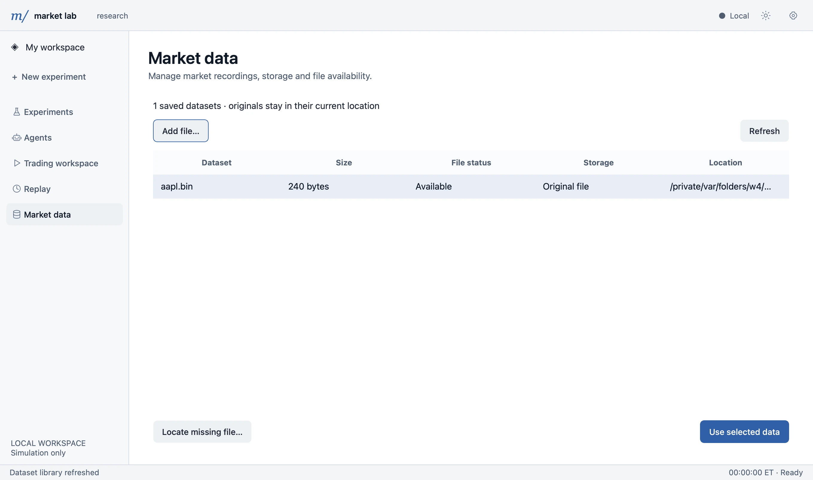

**當時狀態：**清單已加入一份細小嘅合成 `aapl.bin`。呢張唔係你嗰份幾 GB 嘅 Nasdaq 資料。

| 欄位／操作 | 意思 |
| --- | --- |
| Dataset | 資料集名稱；名稱被截短時，停住滑鼠睇完整提示 |
| Size | 檔案大小，自動用 bytes、KB、MB、GB 或 TB；你嗰份應顯示約 8.25 GB；移入滑鼠即顯示完整 bytes |
| File status | Available 表示檔案可用；遺失或改動時要處理返來源 |
| Storage | Original file 係原位引用；App copy 係 App 管理嘅副本 |
| Location | 實際檔案路徑；移入滑鼠即顯示完整路徑 |
| Add file… | 前往主視窗內嘅 Add market data 頁，揀檔案同儲存方式 |
| Refresh | 重新讀取清單同檔案狀態 |
| Locate missing file… | 原檔搬咗位置，重新指出同一份資料喺邊 |
| Use selected data | 將選中資料帶入 New experiment，並開始行情預覽準備 |

大檔加入清單同準備市場係兩回事。準備會讀取行情同建立所需資料，唔係加完檔案就已經完成一次實驗。

**下一步：**選中 Available 嘅資料，撳 Use selected data，喺 New experiment 確認股票同起點。

## 圖 3：Add market data，決定檔案放邊

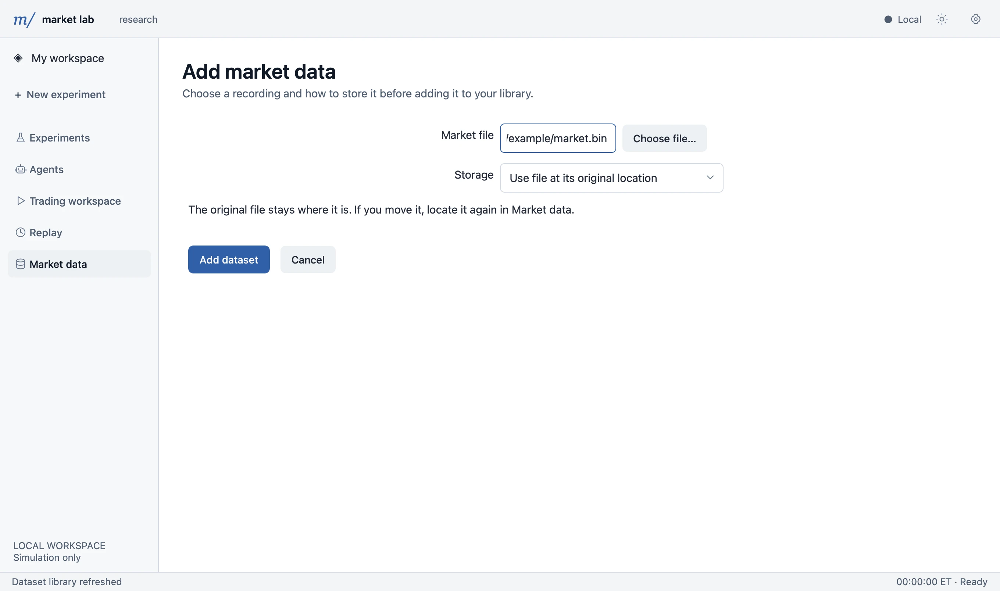

**當時狀態：**Add market data 內頁已揀選檔案，但仲未確認加入。`/example/market.bin` 係展示路徑。側欄仍然保留。

- **Choose file…** 先開系統檔案選擇器，選完即返呢頁；唔會再開另一個 App 設定視窗。

- **Use file at its original location**：繼續讀原檔，唔會額外複製一份。之後搬走原檔，要重新定位。
- **Copy into app-managed storage**：保留一份獨立副本；大檔會用額外磁碟空間，複製亦需時。
- **Add dataset** 確認加入；**Cancel** 返回來源頁，唔會加入檔案。
- 成功後返回原本頁面；失敗會留喺呢頁顯示原因，可以修正再試。
- 清單頁冇 Back 或 Copy checkbox；切頁用側欄，原位／副本只喺加入資料時揀。

**下一步：**幾 GB 嘅檔案，如果你會保留原位，可以先用原位引用；如果想由 App 保管副本，就確認有足夠空間。

## 圖 4：New experiment，設定市場同決策方式

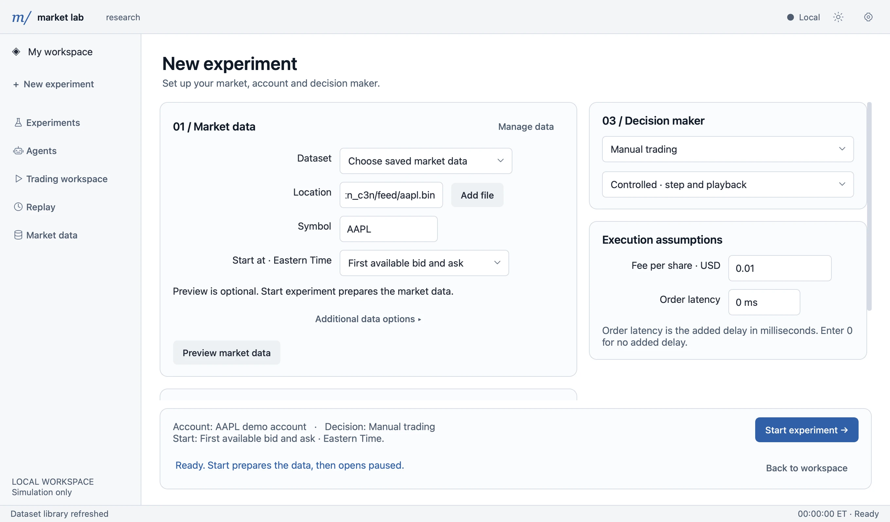

**當時狀態：**正在設定，未開始交易。底部 Ready 表示可以提交準備，唔係話市場已經播放緊。

- **Dataset / Location**：用邊份行情。畫面可能已有 demo 路徑；正式使用要確認係自己想用嗰份。
- **Symbol**：呢次觀察同交易嘅股票代號，必須存在於行情檔內。
- **Start at · Eastern Time**：市場由邊個位置開始。第一次可以用 **First available bid and ask**，等市場有買賣盤先開始。
- **Preview market data**：可選，先睇行情。唔需要每次先撳佢；Start experiment 會自動準備。
- **Decision maker**：第一次揀 **Manual trading**；Rule 係內置規則；Saved Agent 係你已儲存嘅 Agent。
- **Controlled**：用 Play／Pause／Step 控制市場推進。**Live** 係按 1× 時間推進嘅模擬，唔代表真實交易或即時市場資料。Saved Agent 使用 Live 1×。
- **Fee per share · USD**：每股模擬費用。
- **Order latency**：模擬訂單延遲，單位 ms。0 表示唔額外加延遲。

**下一步：**向下捲到圖 5，確認戶口；再撳 Start experiment。大檔可能要等一段時間，完成後實驗會以暫停狀態打開。

## 圖 5：New experiment，下半部嘅 Simulated account

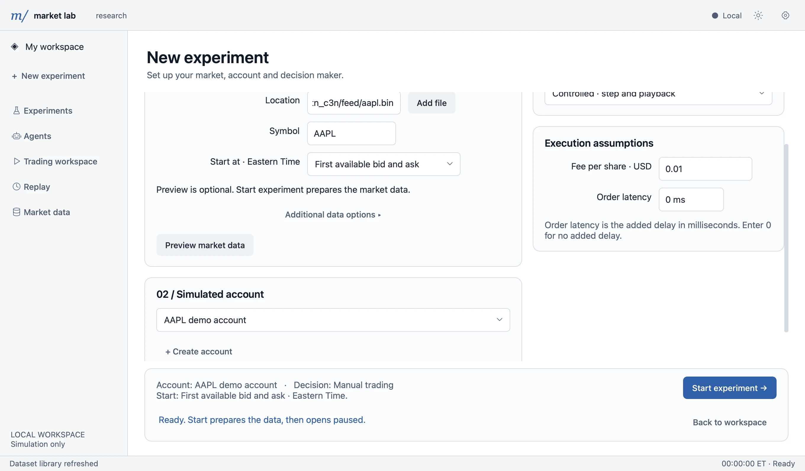

**當時狀態：**同圖 4 係同一個頁面，只係向下捲咗。

- **02 / Simulated account** 揀呢次用嘅模擬戶口。
- **Create account** 喺主視窗打開建立戶口頁，一次過填名稱同起始資金；建立成功會返回設定頁並選中呢個戶口。
- 重用舊戶口會沿用佢而家嘅現金同持倉，唔會每次自動還原本金。做獨立比較時應建立新戶口。
- 底部摘要顯示戶口、決策方式同開始位置；提交前核對一次。

**下一步：**確認戶口，撳 Start experiment，等準備完成，先開始 Play 或 Step。

## 圖 6：Custom time，指定開始時間

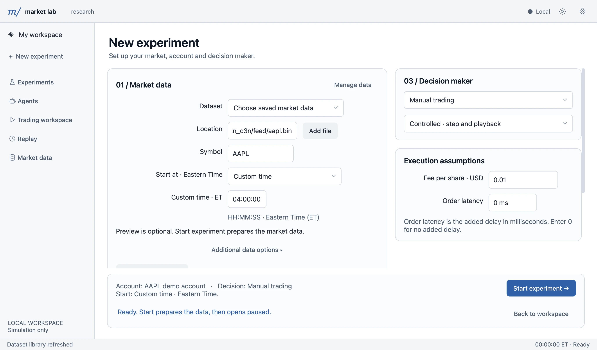

**當時狀態：**Start at 改成 **Custom time**，所以多咗時間欄位。

- 用 **HH:MM:SS** 輸入；呢度係 **Eastern Time（ET）**，唔係你 Mac 所在時區。
- 例如想由正常開市附近開始，可以選 Regular session · 09:30，或者自行指定時間。
- 指定 09:30 唔代表唔使處理之前嘅資料；引擎仍然要準備到選定起點。
- 切返其他起點，Custom time 欄位會隱藏。

**下一步：**第一次唔熟資料內容，可以先用 First available bid and ask。

## 圖 7：Controls & records，人手交易而且暫停緊

**當時狀態：**實際建立咗一個 Manual / Controlled 示範實驗，市場已經有買賣盤，仍然係 **Paused**，未落單。
呢次為咗逐步示範，由 Beginning of file 開始，再用 Step 推進到有買賣盤。
呢個係主視窗內嘅 Trading controls 頁，左上 Back to trading workspace 返回圖表，唔會停止實驗。

| 控制 | 用法 |
| --- | --- |
| Play / Pause | 開始／暫停市場推進 |
| Step | Controlled 模式推進下一個市場處理步驟；唔係保證下一步會成交 |
| 1× 選單 | Controlled 播放速度 |
| 方形 Stop | 結束呢次實驗，並取消未成交訂單；唔等於 Pause |
| Client order name | 自己識別張訂單嘅名稱 |
| Quantity | 買／賣幾多股 |
| Limit / USD | 限價，每股美元價格 |
| Buy / Sell | 提交模擬買單／賣單 |
| Cancel selected order | 先喺 Orders 揀訂單，再取消未成交部分 |

圖中示範係 **10 股、買入限價 $190.10**。呢個價只係配合合成行情，唔應直接照抄去你自己份歷史資料。
限價買單係願意支付嘅最高價；唔係按 Buy 就保證即刻買到。

**下一步：**確認價格同股數，撳 Buy，去 Orders 睇有冇 Accepted／Rejected；再 Step 或 Play，觀察有冇成交。

## 圖 8：同一次示範，訂單成交之後

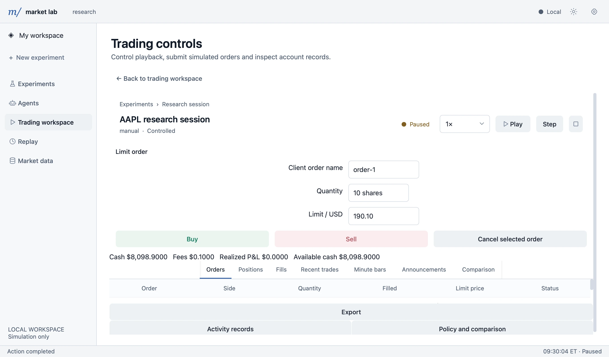

**當時狀態：**前面嗰張 10 股買單經過市場推進，已經產生成交同持倉。呢張由實際模擬引擎執行，唔係手填出嚟嘅結果。

- **Orders**：每張訂單本身，包括總數量、已成交數量、限價同狀態。
- **Positions**：戶口而家持有幾多股票。買入成交後通常會增加持倉。
- **Fills**：每一次實際成交；一張訂單可以分幾次成交。
- **Cash / Fees / Realized P&L / Available cash**：現金、累計費用、已實現損益同可用現金；有掛單時，可用現金可以少過帳面現金。
- **Recent trades / Minute bars / Announcements**：市場資料，唔等於你自己戶口嘅成交。
- **Comparison**：獨立策略比較結果；冇做比較時可以係空白。
- **Activity records** 開事件、決策、交接記錄；**Policy and comparison** 係較進階嘅決策方式切換同比較。
- **Export** 匯出實驗報告，唔係將原始行情檔轉換格式。

圖中 10 股全部以 $190.10 買入，費用合共 $0.10，所以現金係 $10,000 − $1,901 − $0.10 = **$8,098.90**。現金減少唔等於虧損同樣金額，因為戶口多咗 10 股股票。

**下一步：**互相比較 Orders、Positions 同 Fills。完成觀察後撳 Stop，再去 Experiments。

## 圖 9：Trading workspace，有 Agent 活動嘅展示畫面

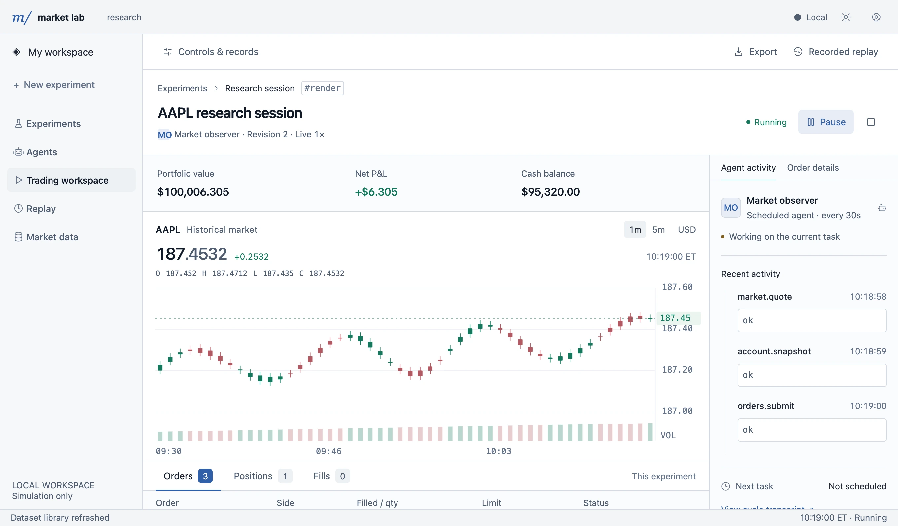

**當時狀態：**呢張係獨立嘅合成介面展示，示範「Market observer / Revision 2 / Live 1×」運行中嘅畫面。
**唔係圖 8 嘅人手交易結果，亦唔係真實 Agent 表現。**

- 上方係實驗名稱、Agent 版本、運行狀態、Pause 同 Stop。
- **Portfolio value** 係戶口組合估值；**Net P&L** 係淨損益；**Cash balance** 只係現金，唔包括持倉市值。
- 中間係選定股票價格、K 線同成交量；**1m / 5m** 係圖表週期，唔係 Agent 思考頻率。
- 圖表時間標示 ET；右側價格係歷史行情嘅模擬市場資料。
- 下方 Orders／Positions／Fills 睇戶口記錄；細視窗可能要向下捲先見到完整表格。
- 右側 **Agent activity** 係近期工具活動，例如 `market.quote`、`account.snapshot` 同 `orders.submit`；`ok` 代表工具呼叫成功，唔代表交易一定賺錢。
- **Controls & records** 切換到主視窗內嘅交易控制頁；**Recorded replay** 帶你去記錄重播；**Export** 匯出報告。

**下一步：**有自己嘅 Agent 實驗時，先核對版本同狀態，再睇 Agent 做咗乜同戶口實際有冇變化。

## 圖 10：Order details，解讀部分成交

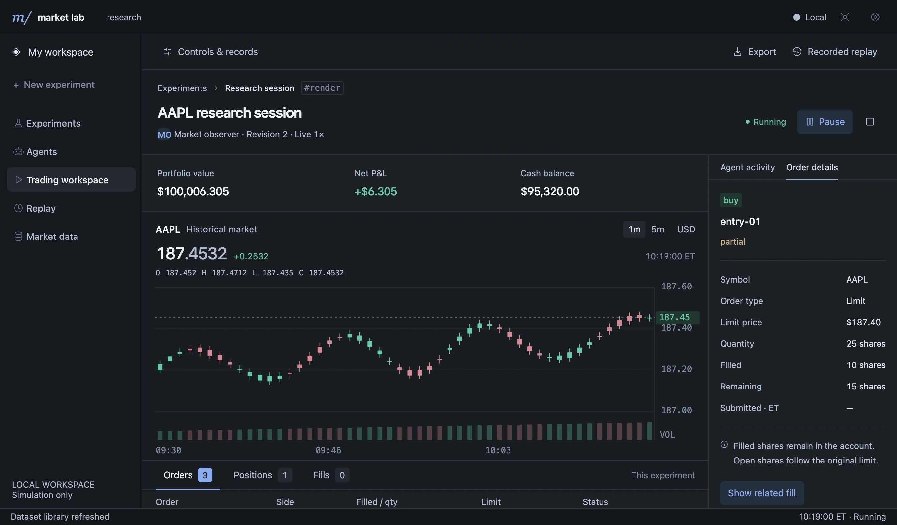

**當時狀態：**同圖 9 嘅展示資料，切咗深色外觀，並選中 `entry-01` 買單。

- **Quantity 25 shares**：原本想買 25 股。
- **Filled 10 shares**：目前成交 10 股。
- **Remaining 15 shares**：仍有 15 股未成交。
- **partial**：部分成交；唔係整張訂單失敗，亦唔係全部完成。
- **Limit price $187.40**：張單嘅限價。實際成交明細要睇 Fills。
- 取消未成交部分唔會撤銷已成交嘅 10 股；嗰 10 股會繼續留喺戶口。
- Submitted 顯示「—」代表呢份展示資料冇提供該時間，唔應當成零點。

呢組畫面係逐項欄位示範，包含獨立嘅表格展示數據；唔適合用各個 badge 數量去核對一份真實交易帳。

**下一步：**自己實驗有 partial 時，先睇剩餘數量，再決定等候、取消，或者用另一張單處理。

## 圖 11：Experiments，搵返儲存結果

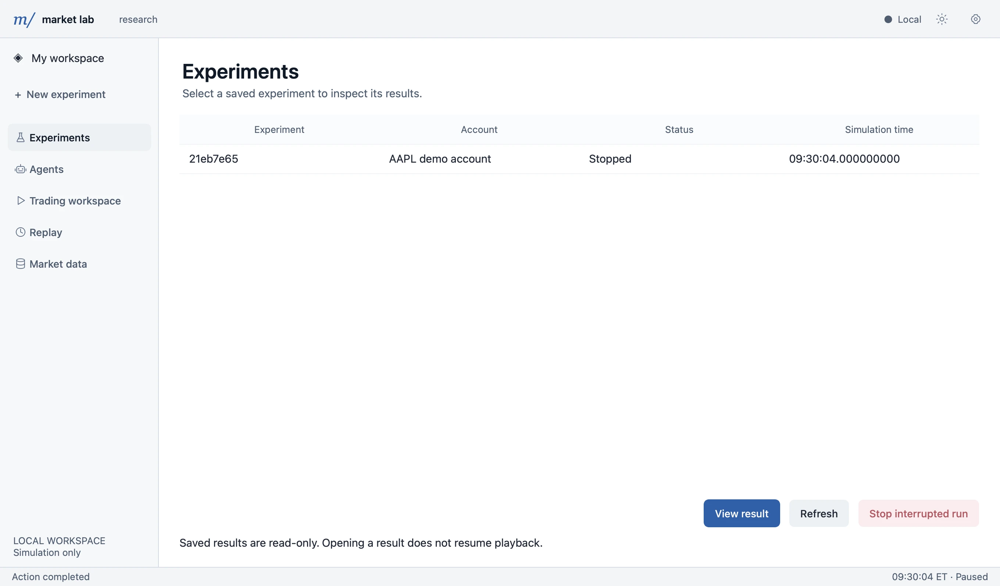

**當時狀態：**圖 7、8 嗰次示範已經停止，清單有一筆實驗記錄。

- 每行係一個實驗，顯示戶口、狀態同模擬時間。
- 選中一行，撳 **View result**，或者雙擊記錄，打開唯讀結果。
- **唯讀結果唔會繼續原本交易**；要做另一輪，就去 New experiment。
- **Refresh** 更新清單。
- **Stop interrupted run** 係處理中斷後遺留嘅實驗記錄，唔係日常開始／恢復按鈕。
- 第一次開 App，清單冇記錄係正常；要先建立過實驗先會有內容。

**下一步：**只想睇結果，用 View result；想驗證原始操作記錄，就去圖 16 至 18 嘅 Live / Replay 流程。

## 圖 12：Agents，管理可重用嘅決策者

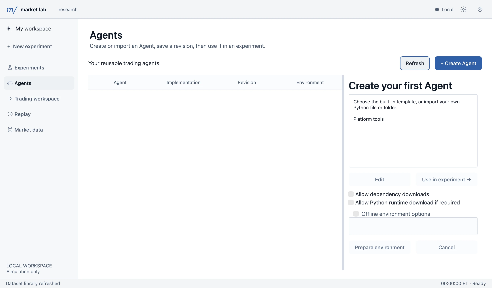

**當時狀態：**仲未儲存 Agent，所以清單空白，Edit、Use in experiment 同 Prepare environment 等操作未可用。

- **Create Agent** 建立內置模板，或者匯入 Python strategy／carrier。
- 清單有記錄之後，選中一個先睇到版本、實作方式同環境狀態。
- **Edit** 儲存修改後建立版本；舊實驗仍用當時嘅版本。
- **Use in experiment** 將 Agent 帶去 New experiment，仲要揀市場同戶口，唔係即刻自動落單。
- 匯入 Python 專案時，用 **Prepare environment** 準備執行環境；下載相關勾選係允許取得依賴或需要嘅 Python runtime。
- Offline environment options 俾已有離線套件／runtime 嘅使用者。

**下一步：**只試人手交易可以跳過呢頁。要試 Agent，先開 Create Agent。

## 圖 13：Agent 編輯器，Agent 分頁

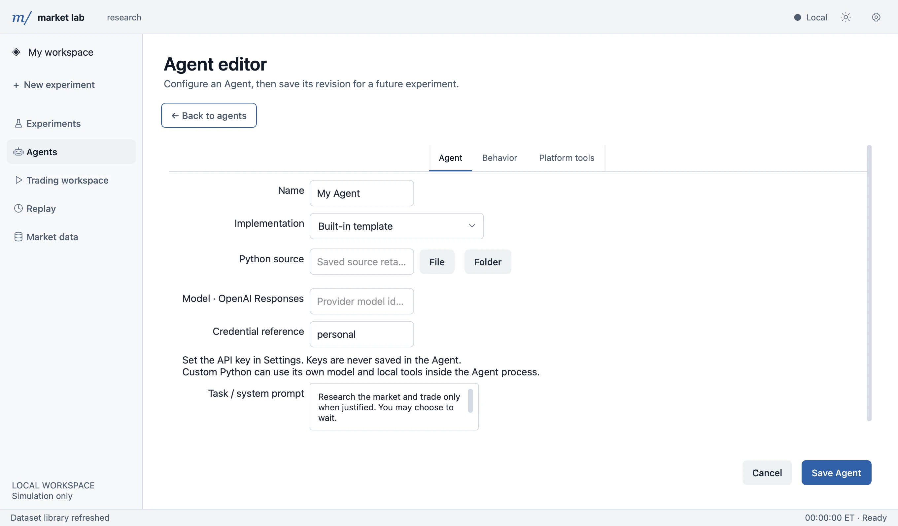

**當時狀態：**正在建立新 Agent，未儲存，亦未執行。

| 欄位 | 用途 |
| --- | --- |
| Name | Agent 名稱 |
| Implementation | 內置模板、Python strategy（平台安排每次工作）或 Python carrier（自己管理迴圈） |
| Python source / File / Folder | 匯入 Python 實作時選程式檔或專案資料夾 |
| Model | 內置模型 adapter 用嘅模型識別名稱 |
| Credential reference | 對應 Settings 入面嘅憑證名稱，例如 personal；唔係 API key 本身 |
| Task / system prompt | 告訴 Agent 呢次要做乜，同應遵守嘅指示 |

**Save Agent 只會儲存設定，唔會開始交易。** 自訂 Python 可以管理自己嘅模型同工具，唔一定全部使用內置 adapter。
呢個編輯器亦留喺主視窗。Back to agents 會保留未儲存草稿；再次進入會繼續編輯同一份草稿。
Cancel 先放棄草稿。儲存期間表單暫停輸入，失敗時會保留內容俾你修正。

**下一步：**再睇 Behavior 同 Platform tools，確認後 Save Agent。之後返 New experiment 揀 Saved Agent 同確切版本。

## 圖 14：Agent 編輯器，Behavior 分頁

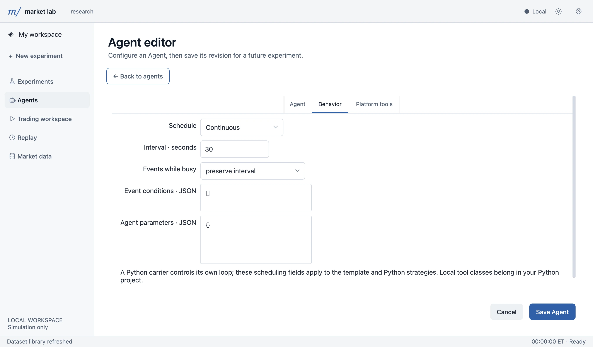

**當時狀態：**仍然係同一個未儲存 Agent，只係切換分頁。

- **Schedule**：連續安排工作、隔指定時間安排，或者由事件觸發。
- **Interval · seconds**：間隔秒數；唔係市場播放速度。
- **Events while busy**：Agent 忙緊時，點樣處理新事件同下一次喚醒。
- **Event conditions · JSON**：事件條件；唔熟悉格式時先保留預設，唔好當普通文字隨便填。
- **Agent parameters · JSON**：傳俾實作嘅參數。
- 呢組平台排程設定適用於模板同 Python strategy；carrier 可以自己管理執行迴圈。

**下一步：**第一次用，先保留預設，確認基本實驗跑得通，再調校排程。

## 圖 15：Agent 編輯器，Platform tools 分頁

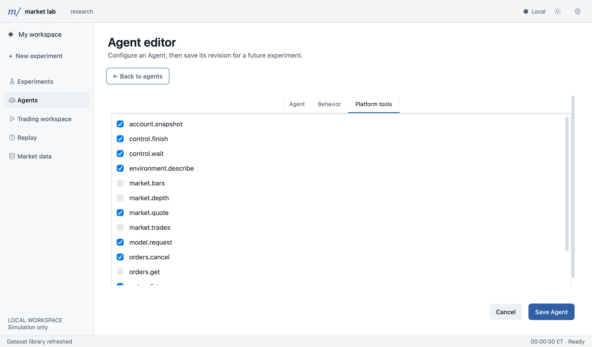

**當時狀態：**設定呢個 Agent 可以使用邊啲平台工具，仲未執行任何工具。

- 勾選代表宣告可用工具，例如讀行情、查戶口、提交訂單、等待或者呼叫模型。
- `market.quote` 係查市場報價，`account.snapshot` 係查戶口狀態，`orders.submit_limit` 係提交模擬限價訂單，`orders.submit_market` 係提交模擬市價訂單（最多比最佳報價差 5%）。
- 取消關鍵工具可能令 Agent 無法完成任務；唔應以為工具愈少或者愈多就一定愈好。
- 呢度係平台工具；自己嘅 Python 分析函式仍然屬於 Agent 專案。

**下一步：**核對工具是否配合任務，再 Save Agent；設定憑證後，喺新實驗揀呢個 Agent。

## 圖 16：另一個 Live 規則實驗，為 Replay 準備記錄

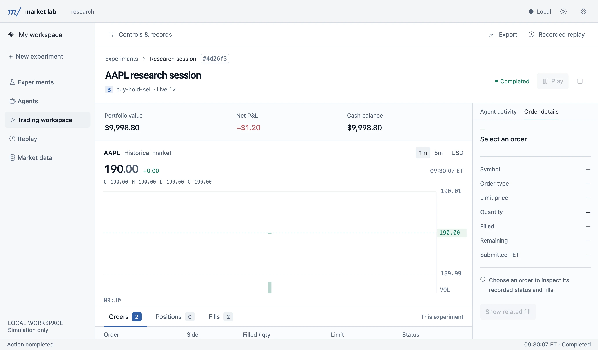

**當時狀態：**用另一個獨立戶口，執行內置 **Rule: Buy → Hold → Sell**，模式係 **Live**，並已經行到結束。呢張係實際規則執行結果，冇用模型或 API key。

- 呢個唔係圖 7、8 嗰個 Controlled 人手實驗；用另一個戶口係為咗保留獨立起始資金。
- 想重現：New experiment → 新戶口 → Rule: Buy → Hold → Sell → Live → Start experiment → 等 Ready → Play。
- 呢份合成行情好短，幾秒就會完；自己嘅歷史檔可以長好多。
- 圖中 Completed，兩張訂單、兩次成交，Positions 為 0；即係已經買入再賣出。最後現金 $9,998.80，淨損益 −$1.20，唔係保證內置規則會賺錢。
- Live 規則／Agent 執行會產生原始操作日誌。**目前 Controlled 人手實驗唔會產生 Replay 所需嘅同類日誌**，唔係所有 Experiments 記錄都可以直接放入 Replay。
- Live 仍然係歷史模擬；內置規則只係功能基準，唔係 AI Agent，亦唔代表一個有投資價值嘅策略。

**下一步：**待實驗完成或正常停止，喺 Replay 開啟呢次產生嘅操作記錄。

## 圖 17：Replay，未選操作記錄

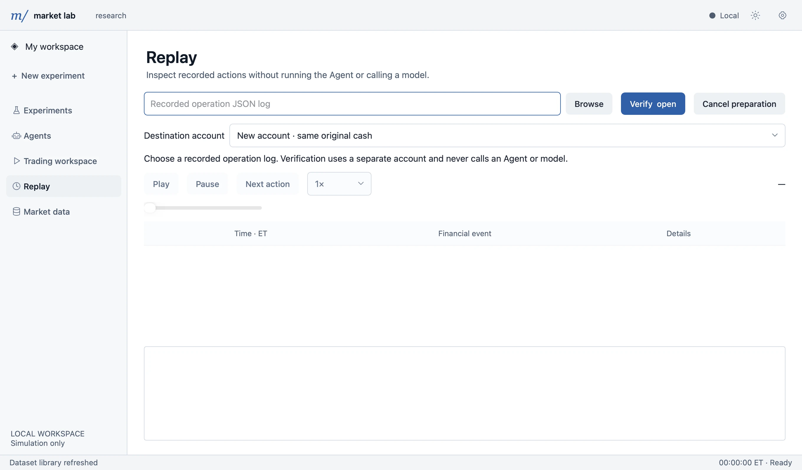

**當時狀態：**未開啟操作日誌，所以下方事件清單空白，播放控制停用。

- **Browse** 揀實驗產生嘅 `.jsonl`／JSON 操作日誌；唔係開 ITCH `.bin`。
- 預設記錄通常喺工作空間嘅 `agent-logs/<run-id>.jsonl`；有自訂位置就用當時指定嗰份。
- **Destination account** 係驗證重播用嘅目標戶口；第一次保留 **New account · same original cash**。
- **Verify & open** 先重建同驗證記錄，唔會重新叫 Agent 思考，亦唔會呼叫模型。
- **Cancel preparation** 取消準備，唔係刪除原實驗。

**下一步：**用已停止或完成嘅 Live 規則／Agent 實驗記錄，揀好檔案再 Verify & open。Controlled 人手實驗目前冇呢種 Replay 操作日誌。

## 圖 18：Replay，驗證完成之後

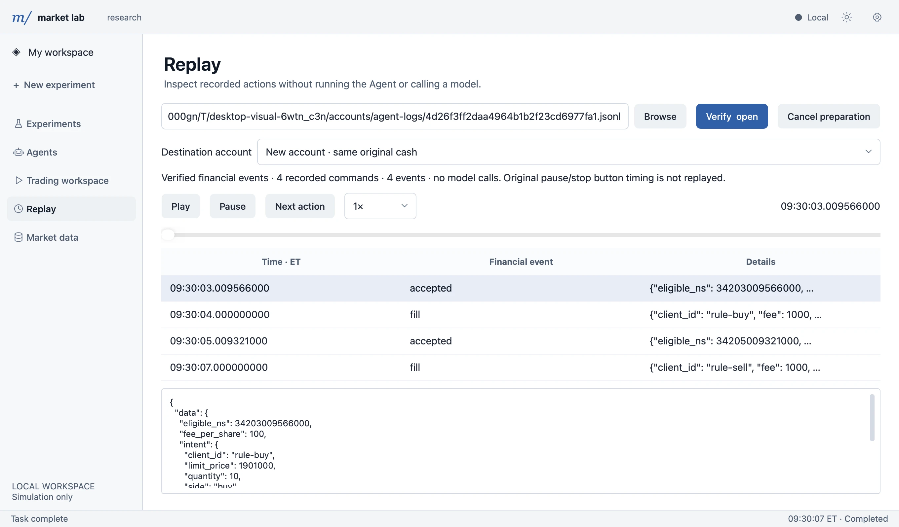

**當時狀態：**已經用圖 16 嘅 Live 規則實驗操作記錄完成驗證，下面有金融事件可以逐項檢查。

- 先睇狀態文字，確認驗證結果；冇事件可驗證同驗證失敗係兩回事，唔好只睇有冇行數。
- **Play / Pause / Next action** 只係控制而家睇緊邊個事件，唔會再落一次單。
- 時間軸可以跳到另一項事件；下方詳細區顯示選中事件嘅原始資料。
- **Time · ET** 係事件時間，**Financial event** 係事件種類，**Details** 係相關內容。
- 呢個頁面重點係驗證同檢查金融結果，唔會照搬原本你撳 Pause／Stop 嘅真人操作節奏。

**下一步：**追查買賣、費用或結果時，逐項對照事件；想試另一個策略，就建立新實驗。

## 圖 19：Settings，上半部嘅模型憑證

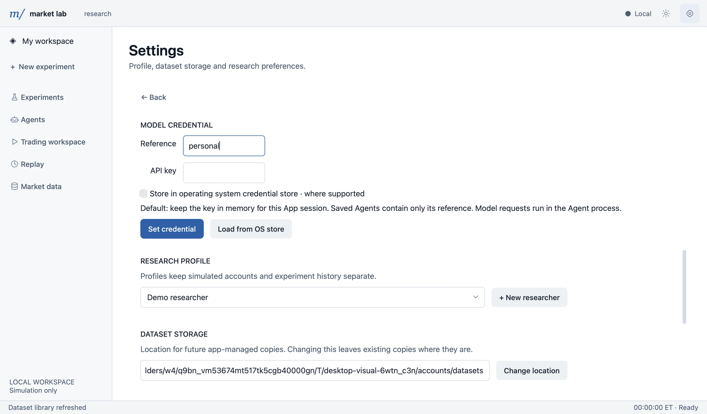

**當時狀態：**未填 API key；圖中 `personal` 只係憑證名稱。

- **Reference** 要同 Agent 編輯器嘅 Credential reference 對應。
- **API key** 係模型服務憑證；撳 **Set credential** 套用。人手或內置規則實驗唔需要模型 key。
- 預設只喺今次 App 工作階段記憶；如要用系統憑證庫，勾選相關選項，支援情況視作業系統而定。
- **Load from OS store** 讀取之前儲存嘅系統憑證。
- **Research profile** 分開不同研究者嘅模擬戶口同實驗記錄。

**下一步：**只做 Manual trading 可以唔填。要跑使用內置模型 adapter 嘅 Agent，先設定對應憑證同模型名稱。

## 圖 20：Settings，下半部嘅儲存位置同重設

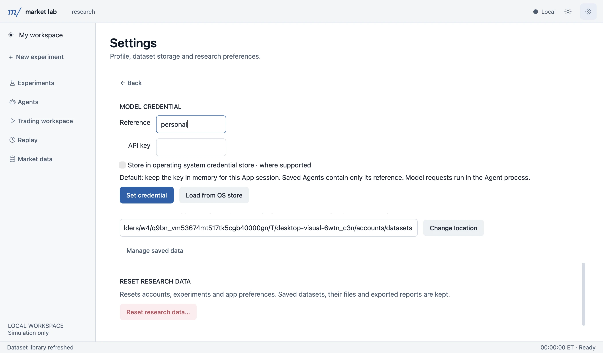

**當時狀態：**同圖 19 嘅 Settings，將下方儲存區向下捲到底。

- **Dataset storage / Change location** 設定之後新複製資料嘅管理位置；唔會自動搬走所有舊副本。
- **Manage saved data** 切換到圖 2 嘅資料管理頁。
- **Reset research data** 會清除研究戶口、實驗同 App 偏好，唔係普通 Refresh。
- 重設會保留已儲存資料集、來源檔同已匯出報告；仍然應細讀確認內容，唔好用佢處理一般播放問題。

**下一步：**平時設定完成用 Back 返回；冇需要清除研究記錄就唔使重設。

## 第一次可以照住做嘅完整路線

1. 用 demo 熟習：喺 repository 執行 `.venv/bin/python -m sim_platform desktop --demo`。示範戶口係臨時嘅，關閉後唔保留；要保存研究就用冇 `--demo` 嘅正常啟動方式。
2. 去 New experiment，確認 AAPL、demo 戶口、Manual trading 同 Controlled。先保留預設起點；如要逐步重現圖 7、8，可以揀 Beginning of file，再 Step 到有買賣盤。
3. 撳 Start experiment，等準備完成。見到 Paused 係正常，仲未播放。
4. 開 Controls & records，核對限價同股數，提交一次細額模擬單；用 Step 睇 Orders 點樣變化。
5. 分開睇 Orders、Positions 同 Fills；未成交唔一定係錯誤，可能係限價或市場流動性未配合。
6. 用 Stop 結束，去 Experiments 睇儲存結果。
7. 熟習之後先用自己嘅大檔；想驗證記錄再學 Replay；想自動決策再設定 Agent。

## 經常會混淆嘅狀態

| 畫面／字眼 | 實際意思 |
| --- | --- |
| No experiment open | 未開實驗，唔代表資料遺失 |
| Preparing | 正在讀取、驗證或準備資料，未可以當作已開始交易 |
| Ready / Paused | 可以準備操作／已暫停；要按當時頁面理解，唔代表播放中 |
| Playing / Running | 正在推進市場或執行決策，仍然係歷史模擬 |
| Accepted | 訂單被接受，未必成交 |
| Partial | 只有部分股數成交 |
| Filled | 該訂單已成交完成 |
| Stopped / Completed | 實驗已停止／完成，唔會自動繼續原本交易 |
| Read-only result | 睇舊結果；唔係一個可恢復執行嘅新實驗 |
| 空白 Agents / Experiments | 未建立相關資料時屬正常；同故障唔係同一回事 |

[使用指南目錄](README.md) · [首次使用與安裝](getting-started.md) · [Controlled / Live 詳解](execution-modes.md) · [影片示範](demo.md)
