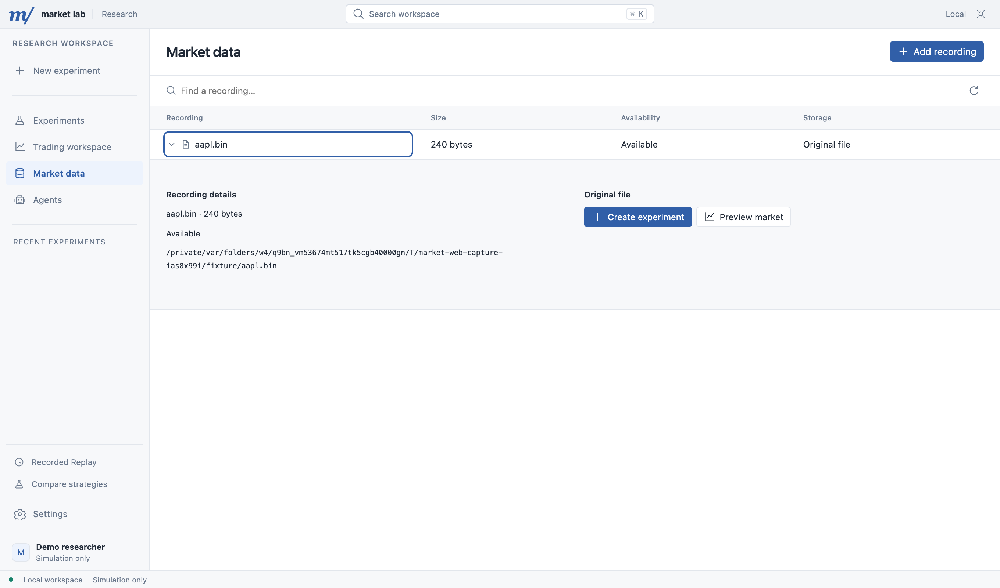
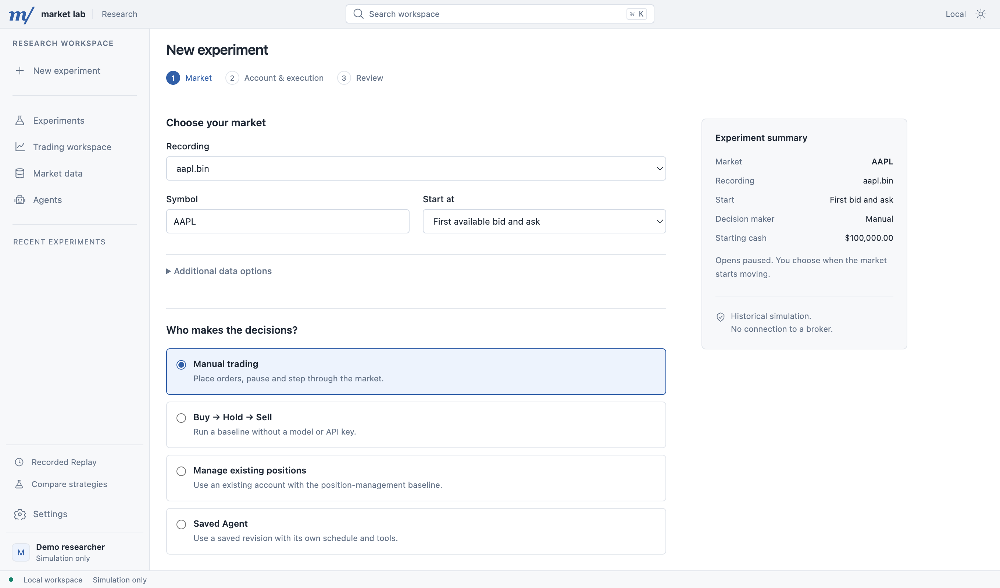
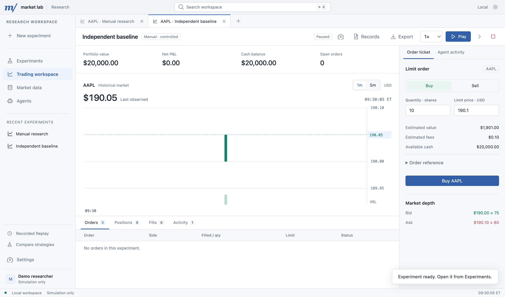
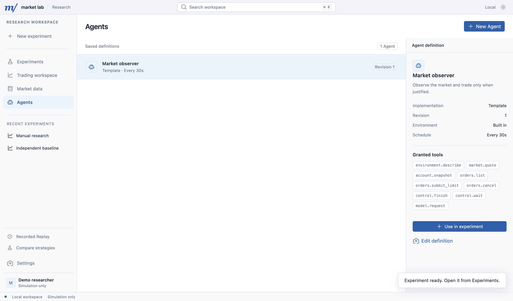
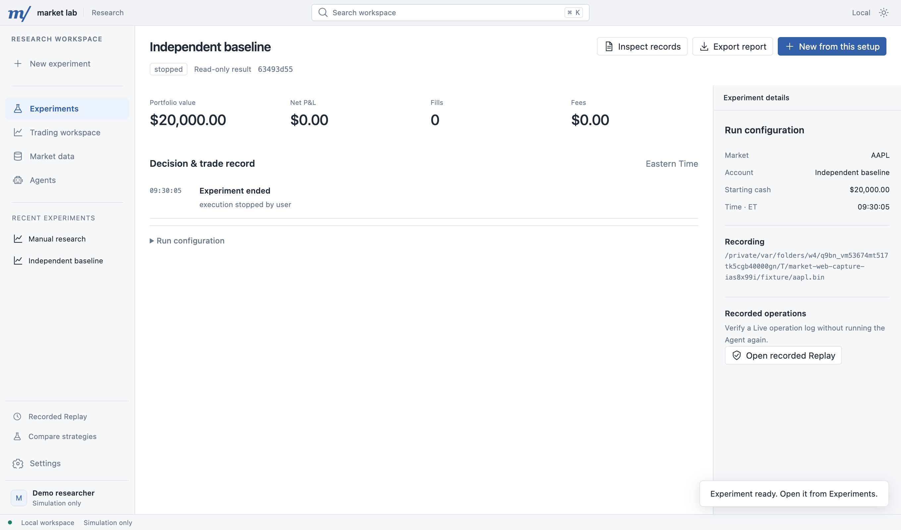

# Desktop 完整操作流程

呢份指南對應預設嘅 HTML Desktop。Market Lab 係歷史行情模擬工具，唔會連接券商。
人手同 Agent 實驗用同一款 Trading workspace，但各自有獨立戶口、訂單同時鐘。
以下截圖使用臨時合成資料展示操作，唔係真實投資回報。

## 開啟

本地打包後可以直接喺 Finder 雙擊 `build/desktop-dist/Market Lab.app`。
呢個係內部候選版，未係已簽署及公證嘅公開下載版。App 已包含 Python、Qt 同原生引擎，
使用者唔使為咗啟動 App 而另外安裝 Make 或 C++ compiler。

開發用 source 版則執行：

```sh
.venv/bin/python -m sim_platform desktop
```

想用臨時示範資料試操作，加 `--demo`。示範戶口同資料會喺退出後移除。
正常工作區資料會保存；退出 App 後，實驗唔會繼續喺背景跑。

## 1. Market data：管理錄影資料

呢頁管理資料，唔會自動開始實驗。展開資料行後，**Preview market** 可以獨立睇行情、買賣盤同逐步播放，唔建立戶口；**Create experiment** 先會進入實驗設定。撳 **Add recording**，再喺匯入頁揀檔案。
支援未壓縮嘅 ITCH BinaryFILE `.bin`／`.itch`；下載嘅壓縮檔要先解壓。

- **Keep in its current location**：只記住原檔位置，唔複製幾 GB 資料。
- **Copy into this workspace**：建立 App 管理嘅獨立副本，需要額外磁碟空間。

撳 **Add recording** 後會顯示進度，亦可以取消。取消唔會刪除原檔，部分完成嘅副本會清理。
成功後返回資料頁。撳某一行會展開該份資料嘅位置、狀態同操作；再撳會收起嗰行資料。



## 2. New experiment：決定今次點樣測試

喺資料詳情撳 **Create experiment**，或由左側 **New experiment** 開始。

1. **Market**：揀錄影、股票代號、開始時間，同由人手、基準策略定 Agent 做決定。
2. **Account & execution**：建立新戶口或選現有戶口，再設定費用、延遲同播放方式。同時開啟嘅實驗唔可以共用戶口。Agent 另有結束時間同任務 timeout。
3. **Review**：核對右側摘要，再撳 **Prepare experiment**。

大檔案準備可能需時，可以取消再試。準備好後先開工作區，初始係暫停狀態。



## 3. Trading workspace：操作同觀察同一個實驗

上方係實驗分頁；每個分頁保留自己嘅落單草稿、側欄、紀錄選項同圖表時間間隔。
其他管理頁唔會變成分頁。

- **Play／Pause**：開始或暫停行情。**Step** 只喺可逐步播放嘅模式提供。
- **Order ticket**：人手填股數同限價，再確認買／賣。估計金額同費用會隨輸入更新。
- **Orders／Positions／Fills／Activity**：分別查看訂單、持倉、成交同活動。
- **Agent activity**：查看 Agent 狀態同工具活動。Agent 掌管決策時唔會同時開放人手落單。
- **Controls**：即時、指定行情時間，或達到持倉數量後轉換決策方式；可以重設或恢復之前策略狀態。
- **Records**：查看已發布嘅財務事件、行情紀錄、決策轉換、Agent 工作／transcript 同 App 活動。撳紀錄行睇詳情。
- **End experiment**：結束實驗、取消未成交訂單並保存結果。

**關閉分頁只係收起畫面，唔等於結束實驗。** 要停實驗請用 End。
行情更新亦唔應該清空你未提交嘅限價，或令游標離開輸入欄。



## 4. Agents：保存策略定義同版本

喺 **New Agent** 填名稱、實作方式、任務同所需設定。保存修改會建立新 revision；
舊實驗繼續用當時選定嘅 revision。

Configured Agent 需要 model identifier 同 credential reference。API key 要喺
**Settings → Model credential** 用同一個 reference 保存，唔好寫入任務或參數。
可以只保存今次工作階段，或選 OS credential store。實際模型請求會使用你嘅服務帳戶。

Python Agent／carrier 先選 source file／project folder，再由詳情撳 **Prepare environment**。
新頁面可以分別選擇容許下載 Python 同依賴 wheels；亦提供離線 archive／wheels folder。
準備環境唔會即刻執行 Agent。Ready 後再撳 **Use in experiment**。



如要喺自己嘅 Python 環境寫 Agent，可以用 **File → Export Agent SDK** 匯出 wheel，
再執行 `python -m pip install /path/to/file.whl`。呢個匯出功能唔代表已上架 PyPI。

## 5. Experiments／結果：翻查之前做過乜

Experiments 係實驗清單。進行中嘅實驗可以返回工作區，已結束嘅實驗則打開唯讀報告。
報告顯示實際帳戶數值同紀錄，可以 **Export report**，唔會重新開始交易。
如果上次因為程式崩潰留低 interrupted run，可以由清單明確結束，保留已有結果。



**Recorded Replay** 用原本 Live operation log 核對財務事件，再逐項查看；唔會重新呼叫模型。
Replay 可以選目的戶口、取消核對同調整播放速度。
**Compare runs** 用嚟比較已完成嘅 run：按 Agent revision、規則設定、model file 或者人手交易自動分組，揀 baseline 同指標之後，會顯示每組平均值、95% 信賴區間、同 baseline 嘅差異同 p 值，Agent run 仲會有「記憶檢查」，詳情睇 [評估指南](evaluation.md)。頁面下面嘅 **Quick rule comparison** 就保留原本功能：喺同一個 recording 上面將 Buy → Hold → Sell 規則跑兩次，一次持倉 1 秒、一次 2 秒，各自用新嘅模擬戶口，比較權益、已實現盈虧、手續費同成交數，完成後可以匯出結果。

## 6. Settings、選單同退出

Settings 管理外觀、researcher、憑證同未來副本儲存位置。
**Reset local workspace** 會刪本地實驗、戶口、定義同資料登記；原始錄影保留，亦冇自動備份。
有實驗或背景工作未完成時唔可以重設；執行前會再確認。

macOS 頂部選單包括 Market Lab、File、Edit、View、Experiment、Window 同 Help。
喺獨立 `.app` 入面會顯示 App 名；經 source Python 指令開啟仍可能顯示 Python。
常用快捷鍵：Command-N 新實驗、Command-O 加資料、Command-K 搜尋、Command-comma 設定、
Command-Return 播放／暫停、Command-W 收起實驗分頁、Command-Q 退出。
View 亦有放大／縮小；搜尋支援 Escape、Cancel 同撳外圍關閉。

有進行中實驗、背景工作或未保存表單時，退出會先確認。**Cancel** 保留工作；
確認退出會結束實驗、取消背景工作，等資源關閉及結果保存後先關視窗。
如果只係畫面 renderer 出問題，可以用 **Reload workspace** 重新連接現有引擎。

[英文完整指南](desktop.md) · [發布前驗證及限制](../development/desktop-release.md)
